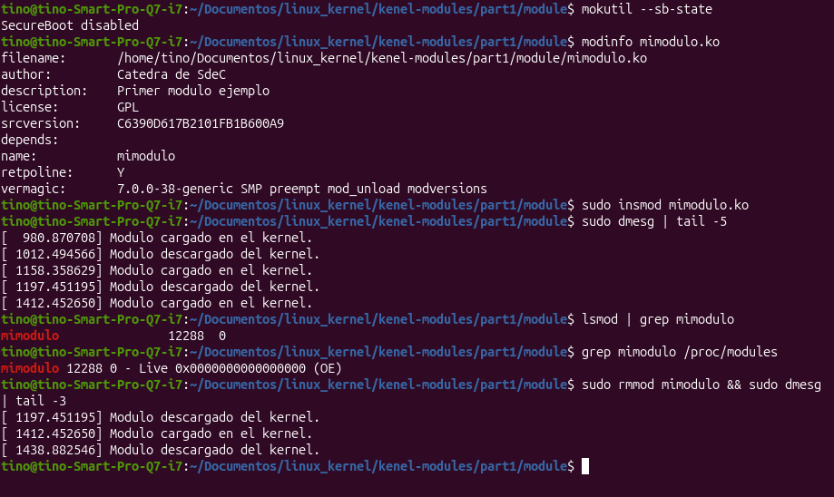
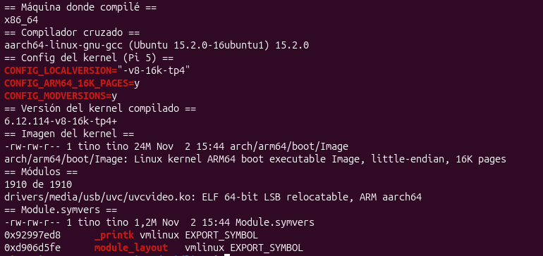
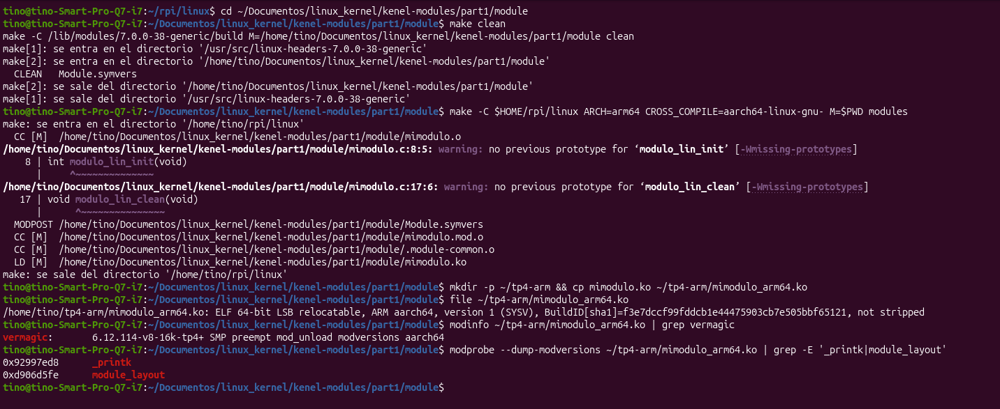
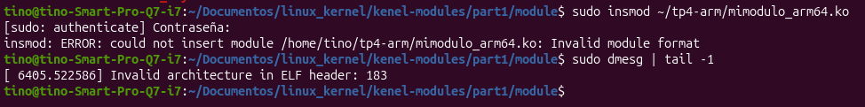
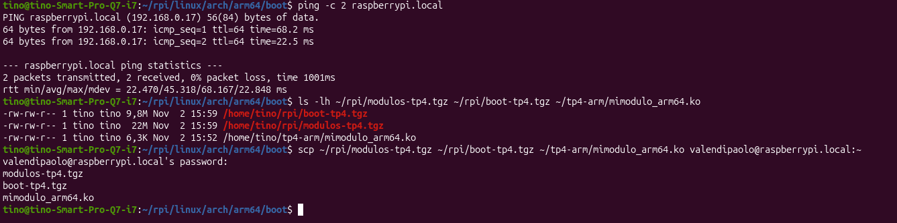
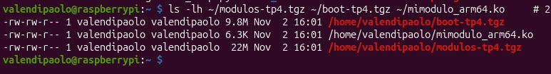
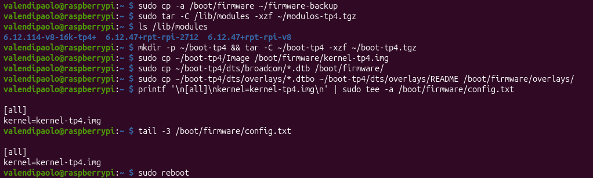
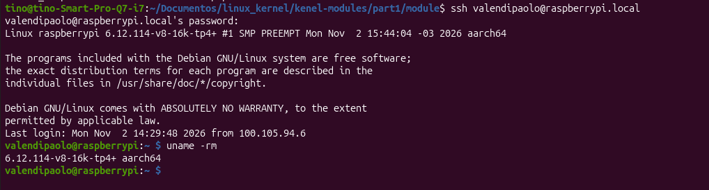
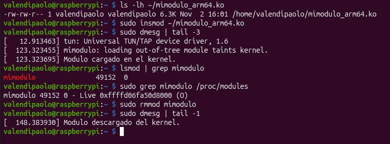

# TP4: Módulos del kernel de Linux y compilación cruzada para Raspberry Pi 5

**Sistemas de Computación** · FCEFyN, Universidad Nacional de Córdoba

**Grupo dontReadME:** Valentino Di Paolo, Maria Pia Acuña

**Repositorio:** <https://github.com/valendipaolo/tp4-kernel>

**Noviembre de 2026**

---

## 1. Consigna

> **¿Qué es exactamente un módulo del núcleo?** Los módulos son fragmentos de código que se pueden cargar y descargar en el kernel según se requiera. Extienden la funcionalidad del kernel sin necesidad de reiniciar el sistema. Por ejemplo, un tipo de módulo es el controlador de dispositivo, que permite que el núcleo acceda al hardware conectado al sistema. Sin módulos, tendríamos que construir kernels monolíticos y agregar nuevas funciones directamente en la imagen del kernel. Además de tener kernels más grandes, esto tiene la desventaja de requerir que reconstruyamos y reiniciemos el kernel cada vez que queramos una nueva funcionalidad.
>
> Croscompilar el módulo desde la PC para ARM, intentar cargar el módulo en la PC y verificar que no se puede cargar. Copiarlo en una Raspberry y verificar que se puede cargar.

## 2. Marco teórico

### 2.1 Módulo del kernel

Un módulo es un archivo `.ko` que se carga en el kernel mientras el sistema está funcionando (`insmod`) y que se puede sacar después (`rmmod`), sin reiniciar. Al cargarse ejecuta su función de inicio, y al descargarse, su función de salida. En el caso de `mimodulo`, las dos funciones solo escriben un mensaje en el log del kernel, que se ve con `dmesg`.

### 2.2 Compilación cruzada

Compilar de forma cruzada es compilar en una máquina un programa que va a correr en otra que tiene un procesador distinto. En este trabajo compilamos, en una PC con procesador x86_64, un módulo para la Raspberry Pi 5, que tiene un procesador ARM de 64 bits (aarch64). Para eso usamos el compilador `aarch64-linux-gnu-gcc`.

### 2.3 Por qué también hubo que compilar el kernel

Un módulo no se compila solo: se compila contra el kernel en el que se va a usar, y al cargarlo, ese kernel verifica que el módulo sea compatible con él. Entonces, para compilar el módulo para la Raspberry necesitábamos tener en la PC el kernel de la Raspberry ya compilado. Por eso primero compilamos en la PC el kernel completo de la Raspberry Pi, después lo instalamos en la Raspberry y recién entonces compilamos el módulo.

## 3. Entorno de trabajo

|  | PC (donde se compila) | Raspberry Pi 5 (donde se ejecuta) |
|---|---|---|
| Procesador | x86_64 | ARM de 64 bits (aarch64) |
| Sistema operativo | Ubuntu | Raspberry Pi OS |
| Kernel | `7.0.0-38-generic` | original: `6.12.47+rpt-rpi-2712`<br>compilado en este TP: `6.12.114-v8-16k-tp4+` |
| Compilador | `gcc` (nativo) y `aarch64-linux-gnu-gcc` 15.2.0 (cruzado) | — |

- **Código fuente del kernel de la Raspberry:** <https://github.com/raspberrypi/linux>, rama `rpi-6.12.y`.
- **Módulo usado:** `mimodulo`, del repositorio de la cátedra (`part1/module`).

## 4. Procedimiento

### 4.1 Prueba del módulo en la PC

Primero compilamos `mimodulo` para la PC y comprobamos que se carga y se descarga bien.

```bash
cd part1/module
make
mokutil --sb-state
modinfo mimodulo.ko
sudo insmod mimodulo.ko
sudo dmesg | tail -5
lsmod | grep mimodulo
grep mimodulo /proc/modules
sudo rmmod mimodulo && sudo dmesg | tail -3
```



*Figura 1: mimodulo cargado y descargado en la PC.*

Como Secure Boot está deshabilitado, el kernel acepta el módulo aunque no esté firmado. En `/proc/modules` aparece marcado como `(OE)`: módulo externo al kernel (O) y sin firma (E).

Kernel original de la Raspberry Pi:

```
valendipaolo@raspberrypi:~ $ uname -rm
6.12.47+rpt-rpi-2712 aarch64
```

### 4.2 Paso 1: compilar el kernel de la Raspberry en la PC

```bash
sudo apt install -y git bc bison flex libssl-dev libncurses-dev make crossbuild-essential-arm64
mkdir -p ~/rpi && cd ~/rpi
git clone --depth=1 --branch rpi-6.12.y https://github.com/raspberrypi/linux
cd linux
export ARCH=arm64 CROSS_COMPILE=aarch64-linux-gnu-
make bcm2712_defconfig
./scripts/config --set-str LOCALVERSION "-v8-16k-tp4"
make olddefconfig
make -j$(nproc) Image modules dtbs
```

Usamos la rama `rpi-6.12.y` porque es la misma serie de versiones que traía la Raspberry (6.12). La configuración `bcm2712_defconfig` es la que corresponde a la Raspberry Pi 5. Además, le agregamos `-tp4` al nombre de la versión para distinguirlo del kernel original. La compilación tardó unos 30 minutos.

Para mostrar el resultado:

```bash
uname -m
${CROSS_COMPILE}gcc --version | head -1
grep -E '^CONFIG_(LOCALVERSION|ARM64_16K_PAGES|MODVERSIONS)=' .config
make -s kernelrelease
ls -lh arch/arm64/boot/Image; file arch/arm64/boot/Image
find . -name '*.ko' | wc -l; file drivers/media/usb/uvc/uvcvideo.ko
ls -lh Module.symvers; grep -wE '_printk|module_layout' Module.symvers
```



*Figura 2: kernel de la Raspberry Pi 5 compilado en la PC.*

El kernel se compiló en una PC x86_64 con `aarch64-linux-gnu-gcc`. El resultado fue:

- la imagen del kernel para ARM64 (`Image`, 24 MB);
- 1910 módulos para ARM;
- el archivo `Module.symvers`, que es el que necesita un módulo para compilarse contra este kernel.

### 4.3 Paso 2: compilar mimodulo para ARM

```bash
cd part1/module
make clean
make -C $HOME/rpi/linux ARCH=arm64 CROSS_COMPILE=aarch64-linux-gnu- M=$PWD modules
mkdir -p ~/tp4-arm && cp mimodulo.ko ~/tp4-arm/mimodulo_arm64.ko
file ~/tp4-arm/mimodulo_arm64.ko
modinfo ~/tp4-arm/mimodulo_arm64.ko | grep vermagic
modprobe --dump-modversions ~/tp4-arm/mimodulo_arm64.ko | grep -E '_printk|module_layout'
```

`-C` indica la carpeta del kernel de la Raspberry que compilamos, y `M=` la carpeta del módulo.



*Figura 3: compilación cruzada de mimodulo.*

`file` confirma que el módulo es para ARM aarch64, y `modinfo` muestra que se compiló para el kernel `6.12.114-v8-16k-tp4+`. Los valores de `_printk` y `module_layout` son los mismos que en `Module.symvers` (Figura 2). Las dos advertencias aparecen porque las funciones de `mimodulo.c` no están declaradas como `static`, y no afectan el resultado.

### 4.4 Paso 3: intentar cargarlo en la PC

```bash
sudo insmod ~/tp4-arm/mimodulo_arm64.ko
sudo dmesg | tail -1
```



*Figura 4: la PC rechaza el módulo compilado para ARM.*

La carga falla con `Invalid module format`, y en `dmesg` se ve el motivo: `Invalid architecture in ELF header: 183`. El 183 es el número que indica, dentro del archivo, que el módulo es para ARM64. Como el kernel de la PC es x86_64, lo rechaza.

### 4.5 Paso 4: instalar el kernel nuevo en la Raspberry

En la PC empaquetamos el kernel y lo mandamos a la Raspberry por la red, junto con el módulo:

```bash
cd ~/rpi/linux
KREL=$(make -s kernelrelease)
make INSTALL_MOD_PATH=../stage INSTALL_MOD_STRIP=1 modules_install
tar -C ../stage/lib/modules -czf ../modulos-tp4.tgz "$KREL"
cd arch/arm64/boot
tar -czf ~/rpi/boot-tp4.tgz Image dts/broadcom/*.dtb dts/overlays/*.dtbo dts/overlays/README
ping -c 2 raspberrypi.local
scp ~/rpi/modulos-tp4.tgz ~/rpi/boot-tp4.tgz ~/tp4-arm/mimodulo_arm64.ko valendipaolo@raspberrypi.local:~
```



*Figura 5: envío de los archivos desde la PC a la Raspberry.*



*Figura 6: archivos recibidos en la Raspberry.*

En la Raspberry:

```bash
sudo cp -a /boot/firmware ~/firmware-backup
sudo tar -C /lib/modules -xzf ~/modulos-tp4.tgz
mkdir -p ~/boot-tp4 && tar -C ~/boot-tp4 -xzf ~/boot-tp4.tgz
sudo cp ~/boot-tp4/Image /boot/firmware/kernel-tp4.img
sudo cp ~/boot-tp4/dts/broadcom/*.dtb /boot/firmware/
sudo cp ~/boot-tp4/dts/overlays/*.dtbo ~/boot-tp4/dts/overlays/README /boot/firmware/overlays/
printf '\n[all]\nkernel=kernel-tp4.img\n' | sudo tee -a /boot/firmware/config.txt
sudo reboot
```



*Figura 7: instalación del kernel en la Raspberry.*

Copiamos el kernel nuevo con otro nombre (`kernel-tp4.img`) y lo elegimos desde `config.txt`, así el original queda intacto. Para volver al kernel original alcanza con borrar esa línea y reiniciar.

Después de reiniciar:



*Figura 8: la Raspberry arranca con el kernel compilado en la PC.*

La Raspberry arrancó con el kernel `6.12.114-v8-16k-tp4+`, compilado en la PC ese mismo día a las 15:44.

### 4.6 Paso 5: cargar el módulo en la Raspberry

```bash
sudo insmod ~/mimodulo_arm64.ko
sudo dmesg | tail -3
lsmod | grep mimodulo
sudo grep mimodulo /proc/modules
sudo rmmod mimodulo
sudo dmesg | tail -1
```



*Figura 9: mimodulo cargado y descargado en la Raspberry.*

El mismo archivo que la PC rechazó se carga y se descarga sin errores en la Raspberry, y en `dmesg` aparecen los mensajes del módulo.

## 5. Comparación entre la PC y la Raspberry

|  | PC | Raspberry Pi 5 |
|---|---|---|
| `mimodulo_arm64.ko` | No carga | Carga |
| Tamaño en `lsmod` | 12288 (versión x86_64) | 49152 |
| Marcas en `/proc/modules` | `(OE)` | `(O)` |

- **Tamaño:** la Raspberry Pi 5 usa páginas de memoria de 16 KB, y la PC, de 4 KB. En los dos casos el módulo ocupa 3 páginas: 3 × 4096 = 12288 y 3 × 16384 = 49152.
- **Marcas:** en la Raspberry no aparece la E (sin firma), porque el kernel que compilamos no verifica la firma de los módulos. El kernel de Ubuntu de la PC sí la verifica.

## 6. Conclusiones

- Un módulo compilado para ARM no se puede cargar en una PC x86_64: el kernel lo rechaza apenas ve que es para otro procesador.
- Para compilar un módulo para otra máquina hace falta tener compilado el kernel de esa máquina. Esa fue la parte más larga del trabajo; el módulo en sí se compila en segundos.
- Instalando en la Raspberry el mismo kernel que usamos para compilar, el módulo cargó sin problemas.

## 7. Repositorio y scripts

Todo el trabajo está en <https://github.com/valendipaolo/tp4-kernel>. La carpeta `scripts/` tiene los comandos de cada paso:

| Script | Dónde se ejecuta | Qué hace |
|---|---|---|
| `01_pc_compilar_kernel_rpi.sh` | PC | Compila el kernel de la Raspberry |
| `02_pc_crosscompilar_modulo.sh` | PC | Compila mimodulo para ARM e intenta cargarlo en la PC |
| `03_pc_enviar_a_pi.sh` | PC | Manda el kernel y el módulo a la Raspberry |
| `04_pi_instalar_kernel.sh` | Raspberry | Instala el kernel nuevo |
| `05_pi_probar_modulo.sh` | Raspberry | Carga y descarga el módulo |

## 8. Referencias

1. Raspberry Pi. *The Linux kernel* (compilación del kernel y compilación cruzada). <https://www.raspberrypi.com/documentation/computers/linux_kernel.html>
2. *The Linux Kernel Module Programming Guide.* <https://sysprog21.github.io/lkmpg/>
3. Cátedra de Sistemas de Computación (FCEFyN, UNC). Presentación *Linux Kernel Module Programming I* y repositorio *kenel-modules*. <https://gitlab.com/sistemas-de-computacion-unc/kenel-modules>
